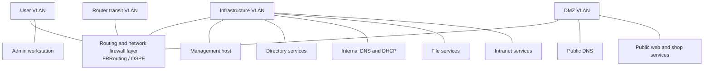

# Architecture

## Logical topology

The diagram shows logical roles, not physical placement or exact interfaces. It is intentionally simplified and omits addresses, hostnames, and detailed firewall paths.

## Segmentation and control layers

Open vSwitch runs on both Ubuntu routers, which act as Layer 3 switches. VLAN 10 carries Users, VLAN 20 Infrastructure, VLAN 30 the DMZ, and VLAN 99 the router transit link. The external-facing interface on the edge router stays outside OVS and OSPF. A transit trunk was tested, but VMware's virtual network did not carry its tagged frames reliably, so both transit switch ports use access mode in VLAN 99.

FRRouting runs OSPF with MD5 authentication across the transit VLAN. Router nftables uses default-deny and anti-spoofing controls; the edge router performs NAT. These router policies remain hand-managed. Host firewalls add a separate layer, including for traffic that stays within one VLAN.

## Services

The lab includes split-horizon BIND DNS, ISC DHCP with relays, Active Directory, file sharing, an internal website, two public web applications, and a dedicated Ansible management VM. Users and Infrastructure use private DNS; DMZ/external clients use public DNS. DHCP serves Users and Infrastructure and reaches the DMZ through a relay.

## Automation path

Ansible runs from a dedicated Infrastructure management VM. A Jinja2 template and shared, zone, and host variables define Linux host firewall rules; `nft -c` validates the candidate before application. Windows firewall playbooks use WinRM for the domain controller and admin workstation. Employee endpoints are managed through AD Group Policy. Routers are intentionally excluded from Ansible.

## Security considerations

- Keep management protocols reachable only from the management/admin paths required by the lab.
- Do not publish actual credentials, encrypted vault files, private addresses, MAC addresses, or internal hostnames.
- The source materials describe WinRM over HTTP on port 5985 with NTLM and disabled certificate validation. For an isolated lab this is a documented limitation, not a strong production configuration; prefer authenticated HTTPS/5986 or another protected management channel where feasible.
- The topology and rules should be reviewed against actual test evidence before claiming enforcement behavior.
