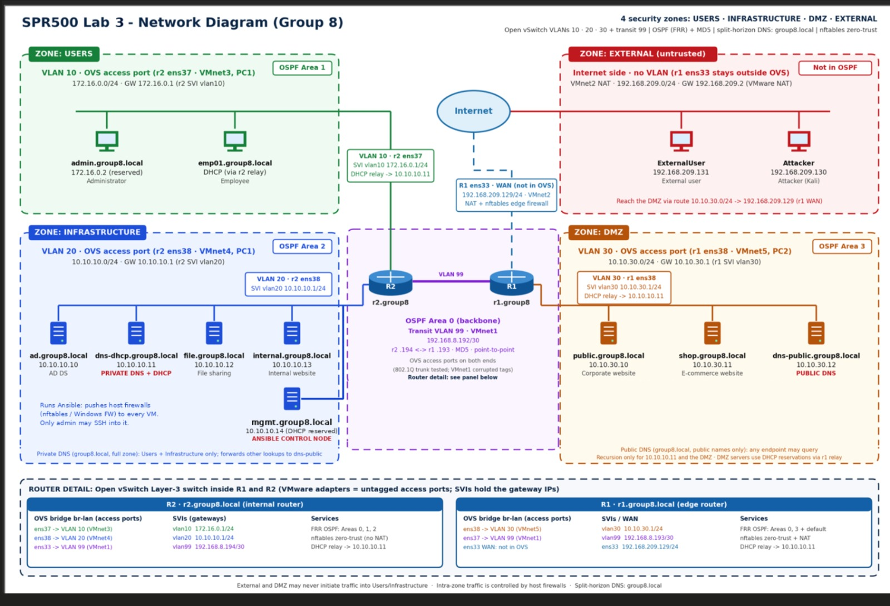

# Segmented Enterprise Network and Firewall Automation Lab

I designed and built a segmented enterprise network in VMware Workstation for Seneca Polytechnic's SPR500 course. The network has four VLANs, two Ubuntu routers running OSPF, core enterprise services (Active Directory, split-horizon DNS, DHCP with relays, file and web services), and two layers of firewalling: hand-written router policies and host firewalls deployed with Ansible.

| | |
|---|---|
| **Environment** | Isolated VMware Workstation lab (no real organization or public system in scope) |
| **Phase 1** | Network foundation, services, and router firewalls |
| **Phase 2** | Host firewalls on Linux and Windows, automated with Ansible |
| **Status** | Built and tested; vulnerability assessment write-up in progress |

## Architecture



- **Switching:** Open vSwitch on both routers, with VLAN SVIs acting as Layer 3 gateways.
- **Routing:** FRRouting OSPF in a multi-area design (backbone on the transit link, one area per segment) with MD5 authentication on area 0. r1 originates the default route.
- **Services:** split-horizon BIND (private DNS for Users/Infrastructure, public DNS in the DMZ), ISC DHCP with relays on both routers, Windows Server Active Directory, an SMB file server, an internal website, and two public web applications.

More detail: [architecture](docs/architecture.md) · [design decisions](docs/design-decisions.md) · [host firewall matrix](docs/host-firewall-matrix.md) · [validation](docs/validation-plan.md)

## Security controls

**Router firewalls (nftables, hand-managed)**
- Default-deny on input and forward chains, with explicit allows for each required flow.
- Anti-spoofing on every interface.
- External and DMZ traffic can never start connections into Users or Infrastructure; Infrastructure cannot start connections to Users.
- Management (SSH/RDP/WinRM) limited to the admin workstation and the Ansible management node.
- Logged drops for every denied path.

**Host firewalls (second layer)**
- **Linux:** default-deny inbound, outbound, and forward. Each host only allows its own service ports from the zones that need them, and SSH only from admin and mgmt.
- **Windows:** Defender Firewall on the domain controller and admin workstation, with RDP and WinRM restricted to the management sources. Employee workstations get their policy from an AD Group Policy Object.

## Automation

Linux host firewalls are generated from a single Jinja2 nftables template, using shared, per-zone, and per-host variables. The playbook checks each rendered ruleset with `nft -c` before writing it, so a broken policy is never loaded. Windows hosts are configured over WinRM with the `community.windows` collection.

See [`automation/ansible/`](automation/ansible/README.md).

## Validation

- 17 functional requirements tested with screenshots: VLAN and OSPF persistence across reboots, DHCP through the relays, private/public DNS behaviour, service access, and blocked paths between zones.
- To prove enforcement, I added a temporary Ansible rule blocking TCP 80/443 from the admin workstation to the public web server, confirmed the block, then removed it.
- Vulnerability scans run with Nessus (internal and external), OWASP ZAP, and WPScan. The written assessment is in progress.

## Repository layout

```
automation/ansible/lab-config/   Ansible inventory, playbooks, variables, nftables template
configs/routers/                 OVS, netplan, FRR/OSPF, DHCP relay, router nftables (r1, r2)
configs/services/                BIND private/public zones, ISC DHCP server
docs/                            Architecture, design decisions, firewall matrix, validation
```

Secrets are excluded: the OSPF key is replaced with `REPLACE_WITH_OSPF_MD5_KEY`, and the Ansible Vault files are not published. Addresses are private lab ranges.

## Skills demonstrated

`Network segmentation` `VLANs / Open vSwitch` `OSPF (FRRouting)` `nftables` `Defense in depth` `Ansible` `Jinja2` `BIND DNS` `ISC DHCP` `Active Directory` `Group Policy` `Windows Defender Firewall` `Nessus` `OWASP ZAP` `WPScan`

## Known limitations and next steps

- WinRM runs over HTTP (5985) with NTLM and certificate validation disabled. That's acceptable in an isolated lab, but the stronger design is WinRM over HTTPS (5986) with trusted certificates.
- The private DNS server forwards all external lookups through the DMZ's public DNS, so internal name resolution depends on a DMZ host.
- The router firewalls are managed by hand. Bringing them under Ansible or version-controlled deployment would remove configuration drift.
- DMZ servers get reserved addresses over DHCP through the edge relay. Static addressing would remove the DMZ-to-Infrastructure DHCP exception.
