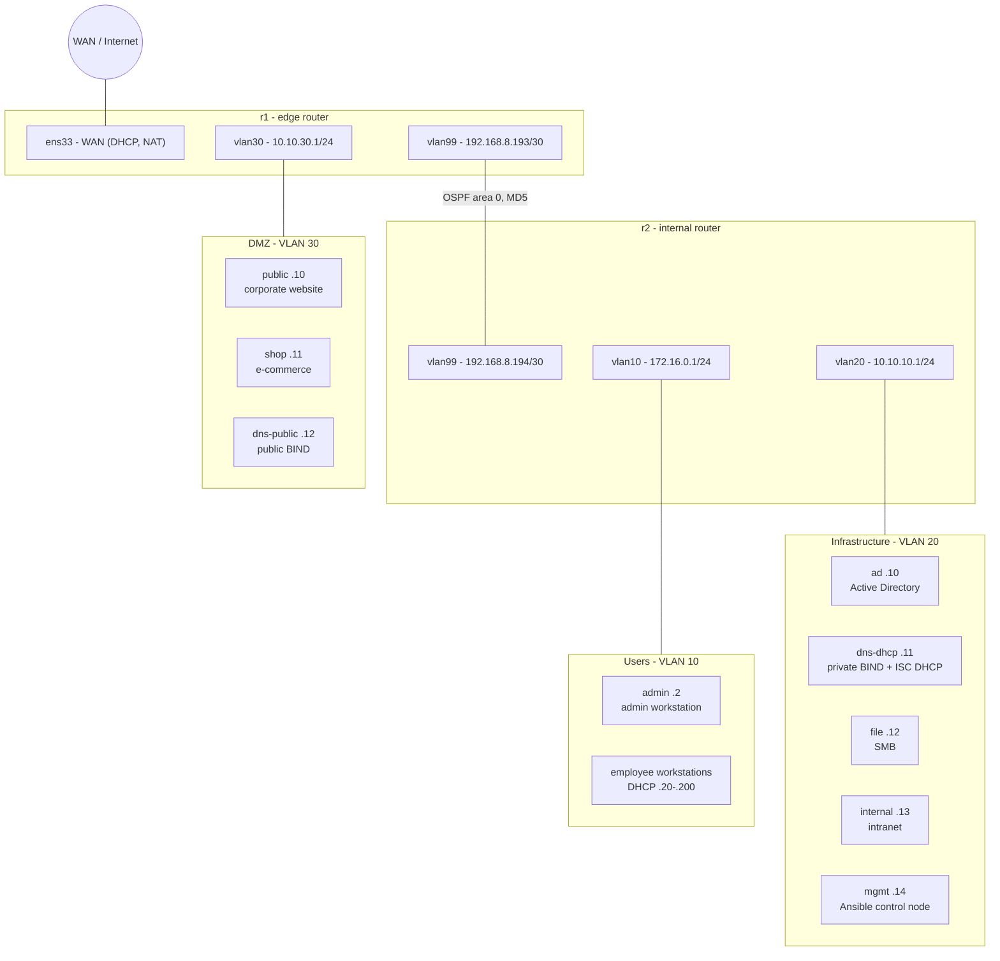

# Architecture

## Topology

| Segment | VLAN | Subnet | Gateway | OSPF area |
|---|---:|---|---|---:|
| Users | 10 | 172.16.0.0/24 | r2 172.16.0.1 | 1 |
| Infrastructure | 20 | 10.10.10.0/24 | r2 10.10.10.1 | 2 |
| DMZ | 30 | 10.10.30.0/24 | r1 10.10.30.1 | 3 |
| Router transit | 99 | 192.168.8.192/30 | r1 .193 / r2 .194 | 0 |

## Switching and routing

Open vSwitch runs on both Ubuntu routers, which act as Layer 3 switches: each VLAN has an internal OVS port (SVI) that carries the gateway address. A systemd unit (`ovs-l3.service`) rebuilds the SVIs at boot, before the network is marked online. The edge router's WAN interface stays outside OVS and OSPF.

I first built the transit link as an 802.1Q trunk, but VMware's virtual network didn't carry the tagged frames reliably. Both transit ports therefore use access mode in VLAN 99.

FRRouting runs OSPF with MD5 authentication on the backbone. The segment interfaces are passive, so OSPF only forms an adjacency across the transit link. r1 originates the default route, and NAT happens on r1's WAN interface.

## Services

- **Split-horizon DNS:** the private BIND server answers Users and Infrastructure. It holds internal A/PTR records and the Active Directory SRV records, and it forwards everything else to the public DNS. The public BIND server in the DMZ answers anyone for the public names. It only allows recursion for the private DNS server and the DMZ.
- **DHCP:** a single ISC DHCP server in Infrastructure serves every segment. r2 relays for Users and r1 relays for the DMZ. Servers receive fixed reservations.
- **Directory and file:** Windows Server Active Directory, plus an SMB file server for Users.
- **Web:** an internal website (Users only), and a corporate website and e-commerce site in the DMZ.

## Firewall layers

1. **Router nftables (r1, r2):** default-deny input and forward chains, anti-spoofing, zone-boundary rules, scoped management access, and logged drops. These rules are maintained by hand.
2. **Host firewalls:** nftables on every Linux server (deployed by Ansible) and Windows Defender Firewall on the domain controller and admin workstation. Employee workstations get their policy from Group Policy. This layer also controls traffic that stays inside a single VLAN and never reaches a router.

## Automation path

Ansible runs from the `mgmt` VM in Infrastructure. Linux hosts are managed over SSH, and the playbook validates each rendered ruleset with `nft -c` before it's installed. The domain controller and admin workstation are managed over WinRM. The routers are intentionally kept out of Ansible.

## Security notes

- Management protocols are reachable only from the admin workstation and the management node.
- WinRM uses HTTP/5985 with NTLM and certificate validation disabled. This is a known lab limitation; WinRM over HTTPS with trusted certificates is the stronger option.
- Credentials live in Ansible Vault and are not published. The OSPF key in these configs is a placeholder.
