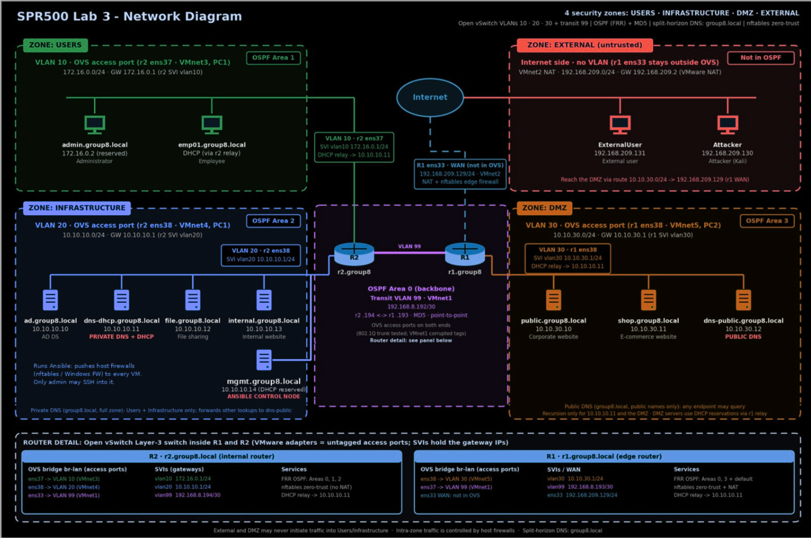

# Sukhmandeep Bamrah

**Cybersecurity & Infrastructure · Seneca Polytechnic**

*Hands-on in network security, enterprise infrastructure, SIEM monitoring, vulnerability assessment, and virtualization.*

🟢 **Open to opportunities**

[Featured Project](#-featured-project) · [Skills](#-technical-skills) · [Homelab](#-homelab) · [Education](#-education) · [Contact](#-contact)

---

## 👋 About Me

I'm an Honours Bachelor of Information Technology – Cybersecurity student at Seneca Polytechnic. I learn by building: segmented enterprise networks, layered firewalls, automated host hardening, and a self-hosted Proxmox homelab. This repository is my central portfolio — a living record of projects, labs, and security-focused technical work from coursework, homelab experimentation, and independent learning.

| 🎯 Focus | 🎓 Education | 🧰 Currently Building |
|---|---|---|
| Network security · Enterprise infrastructure · Security automation | HBIT – Cybersecurity, Seneca Polytechnic (2028) | Detection engineering · SIEM & log correlation · AD security |

---

## 🧪 Featured Project

<h3><a href="Projects/segmented-enterprise-network-lab/">Segmented Enterprise Network and Firewall Automation Lab</a></h3>

Designed and built a segmented enterprise network with four security zones, OSPF routing between two Ubuntu routers, core enterprise services, and **two layers of firewalling**: hand-written router policies plus host firewalls deployed with Ansible.

<table>
<tr>
<td width="50%" valign="top">

**🌐 Network & Services**
- VLAN segmentation with Open vSwitch: Users, Infrastructure, DMZ, transit
- Multi-area OSPF (FRRouting) with MD5 authentication
- Split-horizon BIND DNS and centralized ISC DHCP with relays
- Active Directory, file sharing, internal and public web services

</td>
<td width="50%" valign="top">

**🛡️ Security & Automation**
- Default-deny nftables router firewalls with anti-spoofing, NAT, and drop logging
- Host firewalls on every Linux server from one Jinja2 template, deployed with Ansible and validated with `nft -c`
- Windows Defender Firewall over WinRM; employee workstations through Group Policy
- Vulnerability scanning with Nessus, OWASP ZAP, and WPScan

</td>
</tr>
</table>

**[→ Read the full project write-up](Projects/segmented-enterprise-network-lab/)**

---

## 🛠 Technical Skills

| Area | Skills |
|---|---|
| **Security & Monitoring** | Splunk · Elasticsearch · Logstash · Kibana · Snort IDS/IPS · Sysmon · Wireshark · Nessus · OWASP ZAP · WPScan |
| **Networking & Infrastructure** | TCP/IP · VLAN Segmentation · Open vSwitch · OSPF (FRRouting) · nftables · DNS (BIND) · DHCP · VPN (TUN/TAP) · SSH · Cloudflare Tunnel · Tailscale · Nginx Proxy Manager |
| **Systems Administration & Virtualization** | Linux · Windows Administration · Active Directory · Group Policy · System Hardening · VMware · Proxmox · Hyper-V · Docker |
| **Automation, Programming & Scripting** | Ansible · Jinja2 · Python · Bash · Git · OpenSSL / PKI |

---

## 🖥 Homelab

### Proxmox Virtualization Environment

Self-hosted Proxmox environment running multiple virtual machines and production-grade security services.

| Service | Purpose |
|---|---|
| ☁️ **Cloudflare Tunnel** | Secure public exposure without port forwarding |
| 🔐 **Authelia MFA** | Multi-factor authentication gateway |
| 🔀 **Nginx Proxy Manager** | Reverse proxy with SSL termination |
| 🌐 **Tailscale** | Zero-config remote access VPN |
| 🪟 **Windows Server** | AD, DNS, DHCP lab environment |
| 🐉 **Kali Linux** | Offensive security and penetration testing |
| 🐧 **Ubuntu Server** | General-purpose Linux services |

---

## 🎓 Education

**Honours Bachelor of Information Technology – Cybersecurity (IFS)**  
**Seneca Polytechnic** · Toronto, Ontario · *Expected Graduation: 2028*

<strong>Relevant Coursework</strong>

 

| Domain | Courses |
|---|---|
| Security | Vulnerability & Threat Analysis · Endpoint Security · Network Security · Digital Forensics & Incident Response |
| Infrastructure | Infrastructure Administration · Enterprise Infrastructure & Security · Building Networks |
| Data | Data Services & Management · Digital Data Analytics |

---

## 🔐 Interests & Learning Focus

<table>
<tr>
<td width="50%" valign="top">

**Areas of Interest**
- Cybersecurity Operations
- Enterprise Infrastructure Security
- Threat Detection & Monitoring
- SIEM & Log Analysis
- Network Security
- Virtualization & Homelabs
- Vulnerability Assessment
- Linux Administration
- Security Automation

</td>
<td width="50%" valign="top">

**Current Learning Focus**
- Security Monitoring & Detection Engineering
- Active Directory Security
- SIEM & Log Correlation
- Infrastructure Hardening
- Threat Analysis
- Security Automation & Scripting

</td>
</tr>
</table>

---

## 📫 Contact

- **LinkedIn:** [linkedin.com/in/sukhmanbamrah](https://linkedin.com/in/sukhmanbamrah/)
- **GitHub:** [github.com/ssbamrah](https://github.com/ssbamrah)

---

**Disclaimer:** All projects and labs in this repository are intended for educational and defensive security purposes only. Vulnerability testing and security tooling were performed exclusively within authorized lab and virtualized environments.
